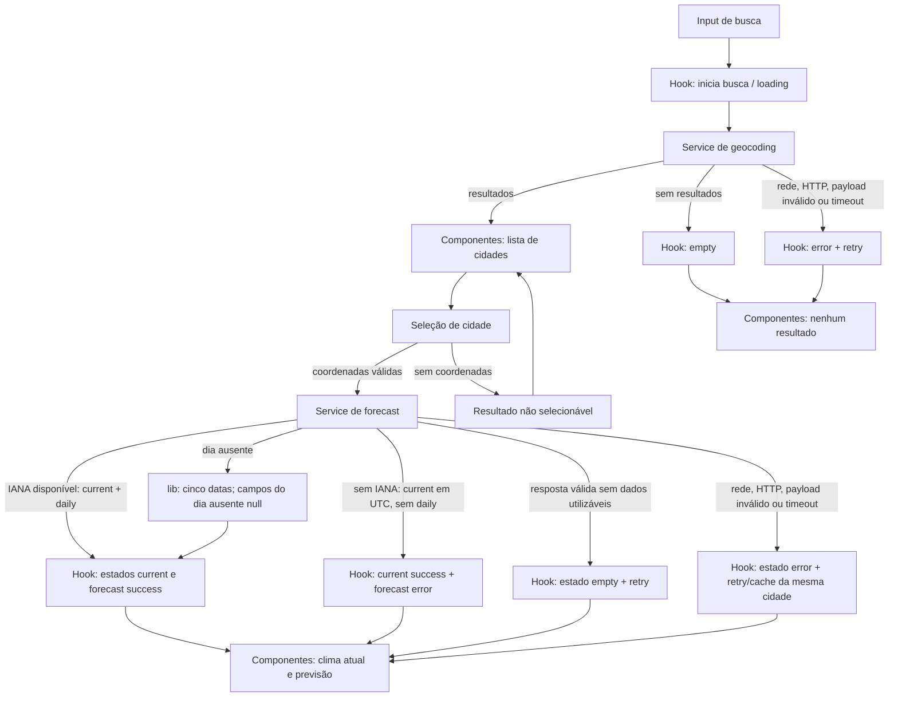

# Plano Técnico: Aplicação de Previsão do Tempo

**Fonte da verdade:** [Especificação do produto](../specs/weather-app-spec.md)  
**Escopo:** baseline de implementação do MVP. Os gates externos descritos na spec continuam obrigatórios antes do release, mas não bloqueiam o desenvolvimento.

## Architecture

```text
Pessoa usuária
  -> components (renderização, eventos e acessibilidade)
  -> hooks (estado, coordenação, retry e identidade das requisições)
  -> services (HTTP, timeout e fronteira Open-Meteo)
  -> Open-Meteo Geocoding API / Forecast API

hooks e services -> lib (mapeamentos e regras puras) -> types (contratos)
```

Aplicação cliente em React com quatro camadas e dependências em direção às integrações. Componentes não acessam a rede diretamente; serviços não controlam estado React; funções de `lib/` não têm efeitos colaterais. O navegador consulta diretamente os endpoints públicos do Open-Meteo, sem backend, conta, chave de API ou persistência remota no MVP (FR-01–FR-04, NFR-07, NFR-10).

- **Apresentação (`components/`):** recebe dados e callbacks por props, exibe estados e conteúdo, e trata interação/acessibilidade. Não conhece endpoints nem inicia chamadas de rede.
- **Orquestração (`hooks/`):** mantém estado da tela, liga eventos aos serviços, controla loading/erro/retry, unidade local e respostas concorrentes/tardias. Não contém detalhes de HTTP nem regras de formatação complexas.
- **Acesso a dados (`services/`):** monta URLs, executa `fetch`, timeout/cancelamento, verifica status e entrega dados normalizados. Isola o provedor para que hooks e componentes dependam de contratos internos, não do formato bruto da API.
- **Funções puras (`lib/`):** converte payloads em modelos, calcula conversões de temperatura, deriva condições pt-BR e datas no fuso da cidade. Não acessa DOM, rede, relógio global ou armazenamento; dependências variáveis, como instante atual, são recebidas como argumentos.
- **Contratos (`types/`):** define modelos de domínio compartilhados sem lógica de apresentação ou integração.

Essa direção permite testar regras de `lib/` como unitários determinísticos; testar serviços com `fetch` controlado, sem renderizar React; testar hooks com serviços simulados e relógio controlado; e testar componentes isoladamente por props e interações. Os testes E2E cobrem o fluxo integrado, com APIs interceptadas. A aplicação não solicita geolocalização. Exibir atribuição ao provedor conforme os termos confirmados para release (NFR-07, NFR-10).

## Tech Stack

| Tecnologia | Uso e justificativa |
|---|---|
| TypeScript strict | Tipos explícitos para respostas externas potencialmente parciais e modelos internos. |
| React 19 + Vite | UI reativa e desenvolvimento/build já configurados no repositório. |
| Tailwind CSS | Estilização responsiva, conforme stack e configuração existentes. |
| Vitest + Testing Library + user-event | Testes unitários e de interação já disponíveis no projeto. |
| Playwright | Testes E2E e validação responsiva dos fluxos essenciais, já disponível. |
| Biome | Lint e formatação definidos nos scripts do projeto. |
| Open-Meteo | Geocodificação e previsão sem chave, acessados diretamente pelo navegador, sujeitos aos gates de termos, limites, atribuição e cobertura da spec. |
| Intl do navegador | Formatação pt-BR de datas/números e localização dos nomes de país quando houver código ISO; sem dependência adicional de runtime. |

Manter Celsius como unidade de transporte e domínio. Fahrenheit é conversão de apresentação; usar as fórmulas, uma casa decimal e arredondamento de empates para longe de zero especificados no baseline. Não introduzir biblioteca de estado nem camada de cache externa para este MVP.

## Project Structure

Estrutura proposta para `src/`, agrupada por responsabilidade. Componentes não importam `services/` diretamente; as dependências seguem a direção da UI para a orquestração e desta para integrações e funções puras.

```text
src/
  components/
    CitySearch.tsx        # campo, resultados e eventos de busca/seleção
    CurrentWeather.tsx    # condições atuais, horário, cache e atualização
    DailyForecast.tsx     # datas e dados diários
    TemperatureUnit.tsx   # controle acessível Celsius/Fahrenheit
  hooks/
    useWeatherApp.ts      # estado e coordenação dos fluxos da aplicação
  services/
    openMeteoService.ts   # URLs, fetch, timeout, abort e erros HTTP
  types/
    weather.ts            # City, CurrentWeather, ForecastDay, WeatherData e Unit
  lib/
    openMeteoMappers.ts   # payloads externos -> modelos de domínio
    temperature.ts        # conversão, formatação e arredondamento
    forecastDates.ts      # datas locais no fuso IANA e lacunas de previsão
    weatherCodes.ts       # códigos WMO -> descrições pt-BR
    freshness.ts          # cálculo de atualidade a partir de timestamps
tests/
  unit/                   # lib, serviços, hooks e componentes
  e2e/                    # fluxos essenciais com Playwright
```

`openMeteoService` isola a rede e usa mapeadores puros de `lib/`; hooks consomem os modelos de `types/` pelos serviços; componentes recebem modelos e callbacks. Manter cada componente React em arquivo próprio. A estrutura é uma proposta para as tarefas de implementação, não exige criar todos os arquivos em uma única etapa.

## Data Model

Tipos de domínio sugeridos a partir dos campos usados dos payloads Open-Meteo. Valores vindos da API devem ser validados e normalizados antes de entrar no estado da UI; campos ausentes permanecem `null`, nunca são inferidos.

```ts
type Unit = "celsius" | "fahrenheit"; // Unidade usada para apresentar as temperaturas.

interface City {
  id: number | null; // Identificador da localidade, quando fornecido pelo geocodificador.
  name: string; // Nome da cidade retornado pela busca.
  adminRegion: string | null; // Região administrativa, se disponível.
  countryName: string | null; // Nome do país retornado pelo geocodificador.
  countryCode: string | null; // Código ISO do país, usado para localizar seu nome.
  latitude: number | null; // Latitude retornada pelo geocodificador; obrigatória para seleção.
  longitude: number | null; // Longitude retornada pelo geocodificador; obrigatória para seleção.
  timezone: string | null; // Fuso IANA retornado para a localidade, se disponível.
}

interface CurrentWeather {
  temperatureC: number | null; // `current.temperature_2m`, normalizada para Celsius.
  weatherCode: number | null; // `current.weather_code`, código meteorológico WMO.
  conditionPtBr: string | null; // Descrição pt-BR derivada do código WMO conhecido.
}

interface ForecastDay {
  date: string; // `daily.time`, data YYYY-MM-DD no fuso IANA da cidade.
  temperatureMinC: number | null; // `daily.temperature_2m_min`, em Celsius.
  temperatureMaxC: number | null; // `daily.temperature_2m_max`, em Celsius.
  weatherCode: number | null; // `daily.weather_code`, código meteorológico WMO.
  conditionPtBr: string | null; // Descrição pt-BR derivada do código WMO conhecido.
}

interface WeatherData {
  city: City; // Localidade à qual todas as informações meteorológicas pertencem.
  current: CurrentWeather; // Condições atuais retornadas pelo endpoint de previsão.
  forecast: ForecastDay[]; // Cinco slots de data local; campos meteorológicos null quando um dia não veio na resposta.
  receivedAt: string; // Instante ISO UTC em que o app recebeu uma resposta válida.
}
```

Busca só pode selecionar cidades com latitude e longitude finitas. Se região e país estiverem ausentes, formatar as coordenadas com duas casas decimais. `WeatherData` guarda Celsius e códigos meteorológicos de origem; a UI deriva a descrição pt-BR e a unidade exibida sem modificar datas ou condições. Construir os cinco slots a partir das datas esperadas no fuso da cidade e associar os registros recebidos por data. Se uma data não vier, manter o slot dessa data com temperaturas, código e condição como `null`; isso representa ausência, sem inventar dados meteorológicos (FR-01–FR-04, AC-01.12–13, AC-02.5, AC-03.4–6, AC-04.5).

As operações também distinguem `empty`: busca concluída sem localidades ou resposta meteorológica sem dados utilizáveis. Resposta parcial com ao menos algum dado útil é `success`, com campos/dias ausentes representados como indisponíveis. Status são independentes para busca, condições atuais e previsão; sem IANA, apenas a previsão fica indisponível e as condições atuais permanecem em `success`.

## Data Flow



1. A pessoa informa e envia o nome da cidade. Remover apenas espaços das extremidades; entrada vazia não chama a API. Bloquear envios enquanto a busca está pendente.
2. O serviço de geocodificação codifica o nome como parâmetro URL, solicita até 10 localidades e preserva a ordem de relevância. Normaliza nome, região, país, código, coordenadas e timezone; resultados sem coordenadas são informativos, mas não selecionáveis.
3. Ao selecionar resultado com coordenadas válidas, guardar essa cidade como seleção vigente e iniciar a consulta. Cada operação tem timeout de 8 segundos e identificador/cancelamento para ignorar respostas de tentativas anteriores ou cidades que já deixaram de estar selecionadas.
4. Com timezone IANA, o serviço solicita condições atuais e cinco dias diários em Celsius nesse fuso. Sem timezone IANA, solicita somente condições atuais em UTC; não solicita nem calcula dias usando o fuso do dispositivo. Registra `receivedAt` no cliente ao receber resposta atual válida, sem confundi-lo com o timestamp de origem do provedor.
5. O estado mantém status independentes para condições atuais e previsão. Com fuso IANA, exibe `receivedAt` na zona da cidade e gera as cinco datas locais esperadas, inclusive em viradas de mês/ano, associando os dados recebidos por data; datas sem registro ficam como indisponíveis. Sem fuso, exibe condições atuais e `Dados obtidos em ... UTC`, mas marca apenas a previsão como indisponível com a mensagem prevista.
6. A UI formata nomes, datas, números e condições em pt-BR. Converter as temperaturas a partir dos valores em Celsius conforme a unidade selecionada. Atualizar explicitamente repete a consulta para a cidade vigente.
7. Uma tentativa falha pode manter o snapshot anterior apenas se for da mesma cidade; apresentá-lo como cache com seu horário original e sua idade. Cidade diferente nunca herda ou exibe dados do snapshot anterior.

Para o limite de atualidade, calcular a idade a partir de `receivedAt`: idade até 60 minutos, inclusive, é atual; acima de 60 minutos é desatualizada. Um timer local pode atualizar apenas esse rótulo quando cruza o limite, sem fazer requisição automática (AC-02.3–4, AC-02.8, AC-02.11).

## External APIs

### Geocoding

- URL: `https://geocoding-api.open-meteo.com/v1/search?name=S%C3%A3o+Paulo&count=10&language=pt&format=json`.
- Parâmetros: `name` recebe a consulta aparada e codificada; `count=10` limita resultados; `language=pt` solicita nomes em português; `format=json` define o formato.
- Exemplo resumido de resposta:

```json
{
  "results": [
    {
      "id": 3448439,
      "name": "São Paulo",
      "latitude": -23.5475,
      "longitude": -46.63611,
      "timezone": "America/Sao_Paulo",
      "country_code": "BR",
      "country": "Brazil",
      "admin1": "São Paulo"
    }
  ]
}
```

- Mapeamento para `City`: `id`, `name`, `latitude`, `longitude` e `timezone` mantêm seus significados; `admin1` vira `adminRegion`, `country` vira `countryName` e `country_code` vira `countryCode`. Tratar propriedades opcionais ausentes como `null`; coordenadas precisam ser finitas para permitir seleção.
- O país deve aparecer localizado em pt-BR quando um código reconhecido permitir; nomes de região podem permanecer conforme fornecidos pelo provedor. Se contexto geográfico estiver ausente, mostrar latitude/longitude com duas casas.
- Sem resultados: preservar a busca, informar que não encontrou cidade e não chamar previsão.

### Forecast

- URL: `https://api.open-meteo.com/v1/forecast`.
- Com timezone IANA, parâmetros: `latitude` e `longitude` da cidade selecionada; `current=temperature_2m,weather_code`; `daily=weather_code,temperature_2m_min,temperature_2m_max`; `temperature_unit=celsius`; `timezone=<IANA>`; `forecast_days=5`.
- Sem timezone IANA, solicitar apenas `current=temperature_2m,weather_code`, com `temperature_unit=celsius` e `timezone=GMT`; omitir `daily` e `forecast_days`. Esse modo preserva as condições atuais sem inventar um fuso local ou usar o fuso do dispositivo.
- Exemplo resumido de resposta (arrays diários alinhados pelo índice):

```json
{
  "timezone": "America/Sao_Paulo",
  "current": {
    "temperature_2m": 21.0,
    "weather_code": 0
  },
  "daily": {
    "time": ["2026-10-27", "2026-10-28", "2026-10-29", "2026-10-30", "2026-10-31"],
    "temperature_2m_min": [16.0, 17.0, 18.0, 17.0, 16.0],
    "temperature_2m_max": [25.0, 26.0, 27.0, 24.0, 23.0],
    "weather_code": [0, 2, 61, 3, 1]
  }
}
```

- Mapeamento para `WeatherData`: associar a `city` à cidade selecionada; mapear `current.temperature_2m` para `CurrentWeather.temperatureC` e `current.weather_code` para `weatherCode`; derivar `conditionPtBr` por tabela de códigos WMO. Com timezone IANA, gerar primeiro as cinco datas locais esperadas e criar um `ForecastDay` para cada uma com campos meteorológicos `null`; associar cada item de `daily.time` à data igual e preencher os campos do mesmo índice. Datas sem registro mantêm seus campos `null` e são exibidas como `Previsão indisponível`; nunca repetir valores de outro dia. Sem timezone IANA, `forecast` fica vazio e somente as condições atuais são mapeadas. Definir `receivedAt` no cliente ao receber resposta atual válida; ele não representa o horário de geração do provedor.
- A resposta do modo com previsão inclui `timezone` para confirmar a zona aplicada; os campos `daily.time` são datas civis nesse fuso. No modo sem timezone IANA, formatar `receivedAt` em pt-BR e identificá-lo como UTC. Nunca usar o fuso do dispositivo como fallback.
- Com timezone IANA, uma chamada retorna condições atuais e previsão diária; sem timezone, usar o modo current-only em UTC. A consulta só ocorre após seleção e é repetida por ação explícita de atualização.
- Sem timezone IANA, não solicitar/calcular a previsão diária e informar `Não foi possível determinar o fuso horário da cidade.`; ainda consultar e exibir condições atuais em UTC.
- Normalizar os weather codes WMO documentados pelo provedor para descrições em pt-BR. Código desconhecido ou campo ausente deve resultar em `Indisponível`, não em descrição inferida.
- Validar status HTTP, formato e campos. Como condições atuais e previsão compartilham endpoint, falha HTTP/timeout afeta a resposta inteira; campos ausentes em JSON válido podem ser apresentados parcialmente, por componente/data.

Ambas as integrações são chamadas diretas do browser e expiram após 8 segundos. Sem chave de API. Confirmar antes do release limites, cobertura, campos, termos, retenção e atribuição, interrompendo o lançamento se incompatíveis (NFR-07, NFR-10).

## State Management

O estado da aplicação vive em React local, coordenado por `useWeatherApp`, sem store global. O hook é a fonte de verdade para consulta, resultados da busca, cidade selecionada, dados meteorológicos, erro da tentativa atual e unidade. Componentes recebem valores e callbacks por props; serviços não mantêm estado de UI.

Busca, condições atuais e previsão têm status independentes, usando o mesmo conjunto explícito. Isso permite manter as condições atuais em `success` enquanto a previsão fica em `error` quando a cidade não tem timezone IANA:

```ts
type AsyncStatus = "idle" | "loading" | "success" | "error" | "empty";
```

- `idle`: nenhuma operação iniciada; para clima, nenhuma cidade selecionada.
- `loading`: requisição pendente; mostrar `Buscando cidades...` ou `Carregando informações do clima...` e impedir duplicatas.
- `success`: resposta com dados utilizáveis. Dados meteorológicos parciais continuam em `success`; cada campo ausente é apresentado como indisponível.
- `empty`: resposta bem-sucedida sem resultados de geocoding ou sem dados meteorológicos utilizáveis. Preservar a consulta de busca; não iniciar uma consulta de clima sem cidade selecionável.
- `error`: falha operacional, resposta inválida, timeout ou impossibilidade de calcular a previsão por falta de fuso. Manter erro e dados de cache como informações separadas.
- `error`: falha operacional, resposta inválida ou timeout da operação correspondente. Sem IANA, somente o status da previsão é `error`; manter as condições atuais válidas e os dados de cache separados do erro.

O hook guarda a unidade selecionada, inicializada de `localStorage` ou Celsius, e persiste a escolha no mesmo navegador/perfil. O serviço de forecast sempre solicita Celsius e `WeatherData` conserva os valores Celsius originais. Na renderização, um formatador puro recebe temperatura original e `Unit`: para Fahrenheit calcula $°F = (°C × 9/5) + 32$; para Celsius usa o valor original. Arredondar a uma casa decimal, com empates para longe de zero, apenas para exibição. A troca da unidade atualiza estado e apresentação de todas as temperaturas sem novo request, sem alterar condições ou datas. Se `localStorage` falhar, manter a escolha em memória.

Serviços recebem `AbortSignal` quando aplicável; um identificador de geração descarta respostas tardias mesmo quando não puderem ser canceladas. Na troca de cidade, ocultar os dados da seleção anterior. Em falha de atualização, manter o último `WeatherData` somente para a mesma cidade, marcado como cache e com `receivedAt` original. A idade é calculada desse timestamp e cache acima de 60 minutos é desatualizado. Não persistir busca, cidade ou clima em servidor; cache em memória da sessão basta para o MVP (FR-02, FR-04, AC-02.9–11, AC-04.1–7).

## Error Handling

| Situação | Comportamento planejado |
|---|---|
| Busca vazia ou sem resultados | Campo vazio não gera request. Resposta de geocoding sem resultados vira `empty`, preserva o texto e não consulta forecast. |
| Falha de rede | Geocoding exibe `Não foi possível buscar cidades.`; falha meteorológica informa indisponibilidade. Oferecer `Tentar novamente` e não descartar cache válido da mesma cidade. |
| Erro HTTP da API ou payload inválido | Tratar como `error`, inclusive HTTP 503; não inferir dados nem considerar resposta inválida como sucesso. Exibir retry. |
| Timeout | Após 8 segundos, abortar a espera, exibir `A consulta demorou mais que o esperado.` e oferecer retry. Ignorar qualquer resposta tardia da tentativa expirada. |
| Resposta parcial utilizável | Manter `success`; exibir campos presentes e `Indisponível` para campo ausente. Data sem registro exibe `Previsão indisponível`; não repetir nem deslocar dados de outros dias. |
| Resposta sem dados meteorológicos utilizáveis | Usar `empty`, informar indisponibilidade e permitir retry; não inventar temperatura, condição ou previsão. |
| Coordenadas ausentes | Resultado de geocoding não pode ser selecionado; não chamar forecast. |
| Fuso IANA ausente/inválido | Manter condições atuais em `success` usando a consulta current-only em UTC; marcar apenas a previsão como `error`, informar `Não foi possível determinar o fuso horário da cidade.` e não calcular datas com o fuso do dispositivo. Exibir `receivedAt` em pt-BR identificado como UTC. |
| Falha de atualização com cache | Manter apenas dados da cidade selecionada, identificá-los como cache e preservar `receivedAt`; marcar desatualizado quando a idade exceder 60 minutos. Nunca rotular cache vencido como atual. |
| Resposta de requisição obsoleta | Cancelar quando possível e descartar resposta se geração ou cidade selecionada não corresponder à operação vigente. |

Erros e estados de loading devem ser anunciados semanticamente, com retry acessível por teclado. Usar as mensagens de carregamento `Buscando cidades...` e `Carregando informações do clima...`. As requisições externas expiram em 8 segundos; retry inicia uma operação nova sem permitir que resultados antigos substituam os mais recentes (AC-01.3–5, AC-01.9–10, AC-02.6–9, AC-02.12, AC-03.4, AC-03.7–9, NFR-05).

## Testing Strategy

Derivar os cenários dos critérios de aceite, usando fixtures, relógio controlado e rede simulada. Testes automatizados não dependem da disponibilidade real do Open-Meteo.

- **Vitest: funções puras de `lib/`:** conversão Celsius/Fahrenheit e formatação (incluindo valores negativos, `0 °C`, uma casa decimal e empates para longe de zero); cálculo do limite de atualidade em 60 minutos; construção das cinco datas no fuso IANA, viradas de dia/mês/ano e ausência de fallback para o fuso do dispositivo; mapeamento de códigos WMO e payloads parciais.
- **Vitest: funções puras de `lib/`:** conversão Celsius/Fahrenheit e formatação (incluindo valores negativos, `0 °C`, uma casa decimal e empates para longe de zero); cálculo do limite de atualidade em 60 minutos; construção das cinco datas no fuso IANA, preenchimento do slot ausente com campos `null`, viradas de dia/mês/ano e ausência de fallback para o fuso do dispositivo; mapeamento de códigos WMO e payloads parciais.
- **Vitest: `services/` com `fetch` mockado:** URL e parâmetros codificados; respostas válidas e sem resultados; HTTP 503, rejeição de rede e JSON inválido; timeout de 8 segundos com relógio falso e verificação do abort; propagação de erros tipados e não substituição de respostas mais recentes.
- **Vitest + Testing Library: componentes e hooks:** renderizar e interagir com os estados `idle`, `loading`, `success`, `error` e `empty` de busca e clima; testar retry, duplicatas bloqueadas, coordenadas ausentes, resposta parcial, cache, atualização manual e resposta tardia de outra cidade. Verificar alternância acessível da unidade, persistência local e que trocar unidade não chama novamente o serviço.
- **Vitest + Testing Library: componentes e hooks:** renderizar e interagir com os estados `idle`, `loading`, `success`, `error` e `empty` de busca, condições atuais e previsão; verificar que sem timezone IANA condições atuais e timestamp UTC continuam visíveis enquanto a previsão mostra indisponibilidade; testar retry, duplicatas bloqueadas, coordenadas ausentes, resposta parcial, cache, atualização manual e resposta tardia de outra cidade. Verificar alternância acessível da unidade, persistência local e que trocar unidade não chama novamente o serviço.
- **Playwright: fluxos E2E:** interceptar Geocoding e Forecast; buscar e selecionar uma cidade, consultar condições e cinco dias, alternar unidade e atualizar manualmente; cobrir nenhum resultado, erro/retry, timeout e resposta tardia sem substituir a cidade atual.
- **Playwright: viewport mobile:** executar o fluxo essencial em `320x800` e `390x844`, além dos viewports de referência `768px` e `1920px`; verificar que busca, resultados, previsão e unidade cabem sem rolagem horizontal.
- **Acessibilidade e compatibilidade:** axe sem violações críticas/sérias e revisão manual de teclado, foco, nomes/estados, contraste e zoom a 200%; fluxos essenciais na matriz de navegadores NFR-06 antes do release.
- **Performance/operação:** medir p95 em 100 execuções, com rede e dispositivos de referência definidos na spec; verificações sintéticas a cada 5 minutos para a meta de disponibilidade de 99,5%. Esses gates dependem do ambiente de release e não são substituídos por testes unitários.

Os comandos existentes no repositório para lint, build e Vitest são `pnpm lint`, `pnpm build` e `pnpm test`; a suíte E2E usa `pnpm test:e2e`.

## Risks & Trade-offs

| Decisão / trade-off | Escolha e consequência | Alternativa considerada |
|---|---|---|
| Open-Meteo direto do navegador | Atende NFR-10 sem backend ou chave; a aplicação fica sujeita à disponibilidade/limites do provedor e transmite consulta e metadados de conexão. Confirmar termos, atribuição, cobertura e limites antes do release. | Criar backend/proxy para controlar cache e ocultar a chamada direta; adiciona infraestrutura e contraria o baseline do MVP. Reconsiderar apenas se os gates externos exigirem. |
| Um endpoint Forecast para condições atuais e dias | Uma requisição reduz latência e coordenação; uma falha HTTP/timeout afeta ambos, embora campos parciais válidos possam ser mostrados. | Consultas separadas para current e daily isolariam falhas, mas aumentariam chamadas, latência e estados de sincronização. |
| Estado local em `useWeatherApp` | Menos abstração para uma única tela e fluxos relacionados; cache e estado não são compartilhados globalmente. | Context ou store (por exemplo, Zustand) facilitaria estado compartilhado em múltiplas telas, mas acrescenta dependência/complexidade sem necessidade atual. |
| Cache meteorológico em memória | Mantém dados durante retry da sessão e evita persistência desnecessária; fechar/recarregar perde o cache e não garante uso offline. | `localStorage`/IndexedDB daria persistência entre sessões, mas exigiria expiração, migração e tratamento de dados antigos; fora do escopo atual. |
| Celsius como unidade de domínio | A API e o modelo mantêm valores-base estáveis; converter na renderização evita novo request e evita acumular arredondamento. | Solicitar Fahrenheit à API quando escolhida reduziria conversão no cliente, mas acoplaria os dados à preferência e exigiria consulta ao alternar unidade. |
| Fuso IANA da cidade | Datas da previsão correspondem ao calendário da localidade; sem fuso válido a previsão fica indisponível. | Usar o fuso do dispositivo permitiria sempre renderizar datas, mas poderia mostrar dias incorretos para a cidade e viola a spec. |
| Preservar dados parciais | Mostra campos e dias disponíveis, sem inventar valores; aumenta a complexidade de estados da UI e testes. | Rejeitar qualquer payload incompleto simplificaria a renderização, mas descartaria dados úteis e viola os critérios de resposta parcial. |
| Mocks nos testes, APIs reais só em gates operacionais | Fixtures deixam Vitest/Playwright determinísticos e independentes do provedor; mocks não comprovam disponibilidade ou cobertura real. | Testes automatizados diretamente contra produção seriam instáveis e poderiam consumir limites; manter verificações sintéticas separadas conforme NFR-04/NFR-10. |

Além dos trade-offs acima, validar timestamps de origem do provedor sem confundi-los com `receivedAt`, códigos WMO desconhecidos, atribuição, acessibilidade e compatibilidade como condições de release. Personas, metas e probabilidades de risco são hipóteses; localização automática, favoritos, histórico, alertas, fallback de provedor, previsão horária e sincronização permanecem fora do MVP.

Personas, metas e probabilidades de risco são hipóteses de planejamento. O plano não aprova gates externos nem amplia o escopo: localização automática, favoritos, histórico, alertas, fallback de provedor, previsão horária e sincronização permanecem fora do MVP.